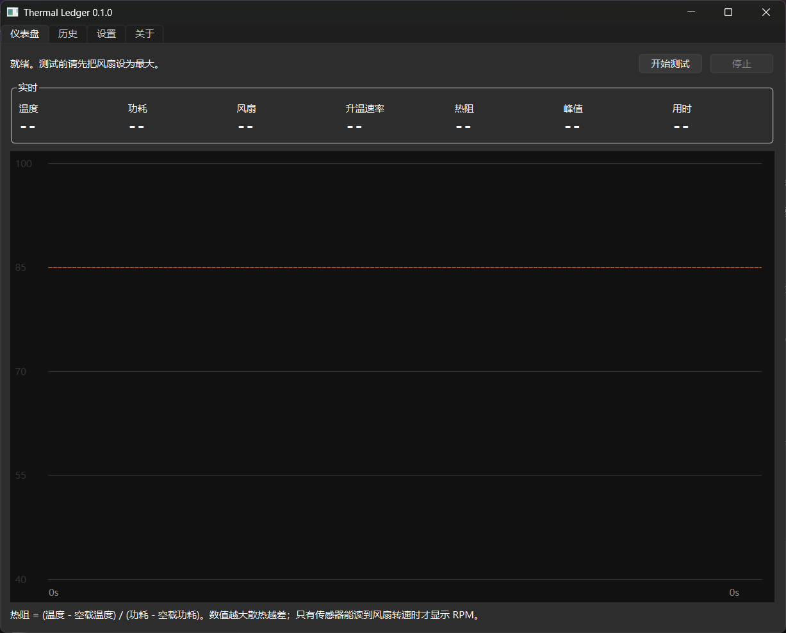

# Thermal Ledger

[中文](README.zh_CN.md) · MIT

**Thermal Ledger** 是一个 Windows 优先、极简、可插拔的 GPU 散热系数与长期记录工具。



它不试图替代 HWiNFO / DeltaT / OCCT，只回答三个问题：

1. 当前散热系数是多少？（ΔT / 功率，实时）
2. 这次运行的散热表现如何？（升温斜率、峰值、热阻、评分）
3. 长期来看，散热是在变好还是变差？（SQLite 历史 + 趋势）

## 特性

- **实时散热系数**：`R = (T - T_idle) / (P - P_idle)`，滚动温度斜率 `dT/dt`
- **可挂任意负载**：
  - `builtin`：内置 CUDA PTX 满载（默认，约 50W）
  - `external`：只监控，你自己开游戏/渲染
  - `command`：启动任意命令并监控
- **可插拔传感器**：NVML 内置；HWiNFO / 厂商 EC / 其他来源通过插件接入
- **风扇 RPM 优先**：能读到就记录并参与展示；读不到显示 `--`，绝不伪造
- **长期记录**：SQLite 保存每次运行与采样，支持 CSV 导出
- **i18n**：Qt `.qm` 翻译，内置 English / 简体中文
- **数据库位置可选**：默认 `%LOCALAPPDATA%\ThermalLedger\thermal.db`，可在设置中修改
- **MIT**：通用核心与厂商专用插件解耦

## 快速开始（源码）

```powershell
uv venv --python 3.12 .venv
uv pip install --python .venv\Scripts\python.exe pyside6
.\.venv\Scripts\python.exe -m thermal_ledger
```

或构建单文件 exe：

```powershell
uv pip install --python .venv\Scripts\python.exe pyinstaller
.\.venv\Scripts\pyinstaller.exe --noconfirm --onefile --windowed --name ThermalLedger src\thermal_ledger\__main__.py
```

## 架构

```
src/thermal_ledger/
  sensors/        传感器接口 + NVML 实现
  loads/          负载接口 + builtin / external / command
  metrics.py      斜率、热阻、评分
  storage.py      SQLite（runs + samples）
  config.py       配置（数据库路径、语言、默认负载）
  i18n.py         Qt 翻译加载
  providers.py    插件发现（entry points）
  app.py          PySide6 GUI
```

### 插件出口

- 传感器：实现 `SensorProvider`，注册 entry point `thermal_ledger.sensors`
- 负载：实现 `LoadProvider`，注册 entry point `thermal_ledger.loads`
- 厂商风扇：单独实现 `FanProvider`（只读），通过传感器插件组合，不把厂商逻辑写进核心

详见 [docs/PLUGINS.md](docs/PLUGINS.md)。

## 数据

| 路径 | 用途 |
|---|---|
| `%LOCALAPPDATA%\ThermalLedger\config.json` | 配置 |
| `%LOCALAPPDATA%\ThermalLedger\thermal.db` | 默认数据库 |
| 设置中可选择任意数据库路径 | 长期记录迁移 |

## 与 DeltaT 的关系

Thermal Ledger 只借鉴 DeltaT 的“按负载/环境归一化”和“长期基线”思路，不复制其代码；功能范围刻意限制在散热系数与记录。DeltaT 仍是更完整的诊断工具，二者可以并用。

## License

MIT. 见 [LICENSE](LICENSE)。
