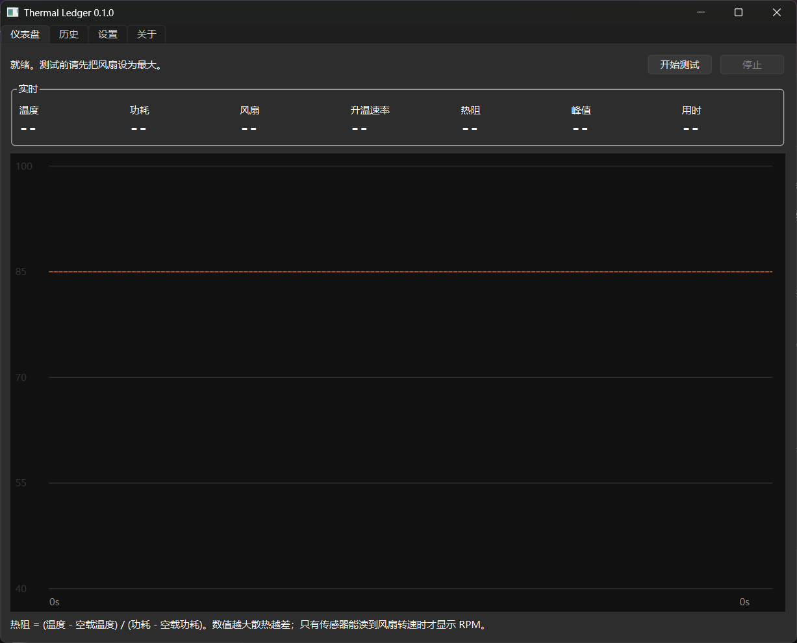

# Thermal Ledger

[English](README.md) · MIT

**Thermal Ledger** 是一个 Windows 优先、极简、可插拔的 GPU 散热系数与长期记录工具。



它只回答三个问题：

1. 当前散热系数是多少？（ΔT / 功率）
2. 这次运行的散热表现如何？（升温速率、峰值、热阻、评分）
3. 长期来看，散热是在变好还是变差？（SQLite 历史）

## 特性

- 实时 `dT/dt` 与热阻 `R = (T - 空载T) / (P - 空载P)`
- 负载可换：内置 CUDA 满载 / 只监控外部负载 / 启动任意命令
- 传感器、风扇、负载全部插件化；核心不含厂商专用代码
- 风扇 RPM 能读到就显示，读不到显示 `--`
- SQLite 保存每次运行与采样，可导出 CSV
- English / 简体中文；数据库路径可自选
- MIT

## 运行

```powershell
uv venv --python 3.12 .venv
uv pip install --python .venv\Scripts\python.exe pyside6
.\.venv\Scripts\python.exe -m thermal_ledger
```

数据库默认：`%LOCALAPPDATA%\ThermalLedger\thermal.db`，可在设置里改。

## 插件

见 [docs/PLUGINS.md](docs/PLUGINS.md)。

## 许可

MIT。
